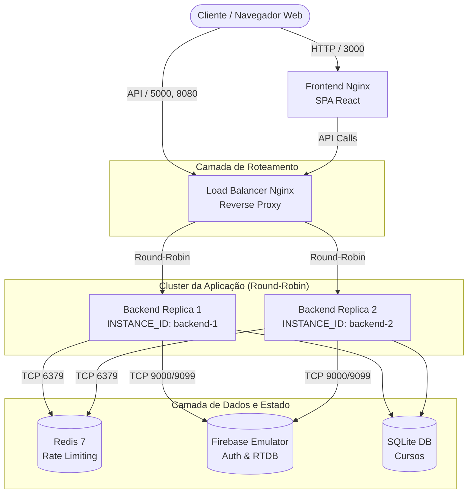

# CourseSphere


Plataforma educacional para consulta de cursos e interação entre estudantes, reestruturada sob os pilares de **Segurança de Aplicações (AppSec)** e **Engenharia de Confiabilidade (SRE)**. Opera em contêineres Docker, com defesa em profundidade, observabilidade em tempo real e alta disponibilidade com balanceador de carga Nginx.

---

## Documentação do Desafio

Os relatórios técnicos e artefatos de governança exigidos no desafio estão organizados em `docs/`:

| Documento | Descrição |
| :--- | :--- |
| **[Relatório Técnico (AppSec e SRE)](docs/RELATORIO_TECNICO.md)** | Documento principal: escopo, metodologia, matriz CVSS, correções com causa raiz, indicadores de confiabilidade (SLIs/SLOs), riscos de disponibilidade e recomendações priorizadas. |
| **[Fichas de Vulnerabilidades](docs/vulnerabilidades/)** | Detalhamento individual de cada falha (VULN-01 a VULN-06) com passos de reprodução e impacto. |
| **[Governança de SRE e Observabilidade](docs/SRE_OBSERVABILIDADE.md)** | Especificação de SLIs/SLOs, cálculo de Error Budget, arquitetura de logs JSON e métricas Prometheus. |
| **[Arquitetura e Alta Disponibilidade](docs/ARQUITETURA_ALTA_DISPONIBILIDADE.md)** | Topologia de rede, upstream pool Nginx, failover passivo e evidência de balanceamento round-robin. |
| **[Modelagem de Ameaças (STRIDE e DFD)](docs/threat-model.md)** | Diferencial: Diagramas de fluxo de dados (Nível 0 e Nível 1), matriz STRIDE e matriz de risco residual. |
| **[Evidências de Auditoria](docs/evidencias/)** | Relatórios brutos de SAST (Bandit), SCA (pip-audit, npm-audit), re-teste ofensivo e logs de balanceamento. |

---

## Arquitetura

O sistema adota uma arquitetura em camadas para isolamento de privilégios e eliminação de pontos únicos de falha:



---

## Resumo das Vulnerabilidades Corrigidas

Todas as seis falhas identificadas na versão inicial foram corrigidas na causa raiz e validadas:

| ID | Classificação OWASP | Severidade | Descrição Resumida | Correção Aplicada |
| :--- | :--- | :---: | :--- | :--- |
| **VULN-01** | Broken Access Control / IDOR | **Crítica (9.1)** | Usuários apagavam e alteravam chats de terceiros. | Decorador `@require_auth` e regras estritas no Firebase RTDB. |
| **VULN-02** | Security Misconfiguration | **Alta (7.5)** | `debug=True` ativo expondo tracebacks em erros 500. | Debug desativado e handlers globais com correlation ID (`X-Request-ID`). |
| **VULN-03** | Injection (SQLi) | **Crítica (9.8)** | Injeção SQL via f-strings em rotas de cursos. | Consultas 100% parametrizadas com bind variables (`?`). |
| **VULN-04** | Identification & Auth Failures | **Alta (8.6)** | Chave de serviço Firebase commitada no repositório. | Segredos removidos do histórico, `.gitignore` e template de exemplo. |
| **VULN-05** | Outdated Components | **Alta (7.5)** | Dependências sem versão mínima contendo CVEs. | Dependências pinadas com versões seguras e auditadas via pip/npm. |
| **VULN-06** | Broken Access Control | **Média (6.5)** | CORS aberto (`*`) e token aceito na query string. | CORS restrito a origens confiáveis e token exigido no header Bearer. |

---

## Hardening

- **Rate Limiting Distribuído:** Controle centralizado no Redis 7 com chaveamento por `g.uid`, `X-Forwarded-For` e IP. Cotas de 10 req/min em rotas sensíveis.
- **Limite de Payload:** Rejeição imediata com HTTP 413 para corpos de requisição acima de 1MB (`MAX_CONTENT_LENGTH`).
- **Headers OWASP:** Injeção de `Content-Security-Policy`, `X-Frame-Options: DENY`, `X-Content-Type-Options: nosniff` e `Referrer-Policy`.
- **Validação de Schemas:** Validação de formato de e-mail, complexidade de senhas e sanitização de mensagens JSON.

---

## Observabilidade e SRE

- **Distributed Tracing:** Injeção e propagação do header `X-Request-ID` entre proxy, aplicação e logs.
- **Logs Estruturados JSON:** Registros com timestamp ISO 8601, nível, rota, código HTTP, latência e ID de instância.
- **Sondas de Saúde:**
  - `GET /health`: Sonda de vivacidade (*liveness*) do processo.
  - `GET /ready`: Sonda de prontidão (*readiness*) testando conexões com SQLite, Redis e Firebase.
- **Métricas Prometheus:** Endpoint `GET /metrics` exportando latência, requisições por status, conexões ativas e saúde de dependências.
- **Dashboard Grafana:** Template pronto para importação disponibilizado em [`infra/grafana/coursesphere-dashboard.json`](infra/grafana/coursesphere-dashboard.json).

---

## Alta Disponibilidade

- **Load Balancer Nginx:** Proxy reverso escutando nas portas `5000` e `8080`, distribuindo tráfego entre `backend-1` e `backend-2`.
- **Algoritmo Round-Robin:** Distribuição equilibrada (50% / 50%) e alternância uniforme entre instâncias.
- **Tolerância a Falhas:** Diretiva `proxy_next_upstream` com remoção temporária de réplicas não responsivas.

---

## Como Executar

### Pré-requisitos
- Docker Engine e Docker Compose (v2.x+)
- Python 3.10+ (opcional, para execução de scripts de validação fora do contêiner)

### 1. Inicializar a Aplicação

```bash
docker compose up -d --build
```

Serviços expostos:
- **Aplicação Web:** `http://localhost:3000`
- **API (via Load Balancer):** `http://localhost:5000` e `http://localhost:8080`
- **Firebase Emulator UI:** `http://localhost:4000`

### 2. Executar os Testes Automatizados

Para rodar todos os 22 testes de regressão, segurança e SRE dentro do contêiner:

```bash
docker exec -it coursesphere-backend-1 pytest tests/ -v
```

### 3. Verificar o Balanceamento de Carga

Dispara 40 requisições sequenciais e analisa a distribuição entre réplicas:

```bash
python scripts/verify_load_balancer.py
```

*Evidência registrada em:* [`docs/evidencias/balanceamento/nginx-round-robin.log`](docs/evidencias/balanceamento/nginx-round-robin.log).

### 4. Executar as Provas de Conceito (Re-teste de Segurança)

Para certificar que todas as 6 vulnerabilidades foram bloqueadas:

```bash
python scripts/pocs/run_all_pocs.py
```

*Evidência registrada em:* [`docs/evidencias/RELATORIO_EXECUCAO_RETESTE.md`](docs/evidencias/RELATORIO_EXECUCAO_RETESTE.md).

---

## Diferenciais

1. **Modelagem de Ameaças (STRIDE & DFD):** Documentado em [`docs/threat-model.md`](docs/threat-model.md) com diagramas de fluxo de dados e análise de risco residual.
2. **Esteira de CI/CD (GitHub Actions):** Configurada em [`.github/workflows/security.yml`](.github/workflows/security.yml) com análise SAST (Bandit), auditoria de pacotes (pip-audit) e testes automatizados com Redis.
3. **Template de Dashboard Grafana:** Arquivo [`infra/grafana/coursesphere-dashboard.json`](infra/grafana/coursesphere-dashboard.json) pré-configurado com os SLIs e SLOs do sistema.
4. **Isolamento Completo:** Execução 100% local com Firebase Emulator Suite, eliminando riscos de vazamento em contas de nuvem pública.

---

## Estrutura do Repositório

```text
CourseSphere/
├── .github/workflows/security.yml   # Esteira de CI/CD para seguranca e testes
├── backend/                         # API Flask com decoradores, handlers e SRE
│   ├── blueprints/                  # Rotas modulares (catalogo de cursos)
│   ├── middleware/                  # Logging estruturado e headers OWASP
│   ├── security/                    # Autenticacao, validacao e rate limiting
│   └── tests/                       # 22 testes automatizados em Pytest
├── frontend/                        # Interface Web em React + Vite + Nginx
├── infra/
│   ├── firebase-emulator/           # Configuracao e regras do emulador
│   ├── grafana/                     # Template de provisionamento do dashboard
│   └── nginx/                       # Configuracao do balanceador de carga
├── docs/
│   ├── RELATORIO_TECNICO.md         # Relatorio tecnico principal do desafio
│   ├── SRE_OBSERVABILIDADE.md       # Governanca de SLIs/SLOs e monitoramento
│   ├── ARQUITETURA_ALTA_DISPONIBILIDADE.md # Especificacao de HA
│   ├── threat-model.md              # Modelagem de ameacas STRIDE e DFD
│   ├── vulnerabilidades/            # Fichas detalhadas de VULN-01 a VULN-06
│   └── evidencias/                  # Logs brutos de SAST, SCA e testes
├── scripts/
│   ├── pocs/                        # Scripts executaveis de Pentest e Re-teste
│   └── verify_load_balancer.py      # Verificador de alternancia de trafego
├── docker-compose.yml               # Orquestracao do cluster completo
└── README.md                        # Documentacao principal
```
