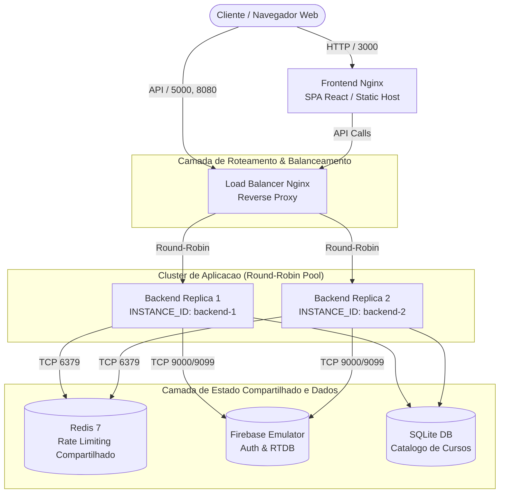

# CourseSphere — Plataforma Segura, Confiável e Altamente Disponível


O **CourseSphere** é uma plataforma educacional para busca de cursos e interação entre estudantes, reestruturada sob padrões rigorosos de **Segurança da Aplicação (AppSec)** e **Engenharia de Confiabilidade de Sites (SRE)**. A arquitetura opera em ambiente conteinerizado, com defesa em profundidade (*defense-in-depth*), observabilidade em tempo real e alta disponibilidade com balanceamento de carga ativo.

---

## 1. Topologia da Arquitetura

A infraestrutura é desacoplada em camadas lógicas para garantir resiliência, eliminação de pontos únicos de falha (*no SPOF*) e isolamento de privilégios:



---

## 2. Matriz de Vulnerabilidades & Remediações

Todas as vulnerabilidades identificadas na auditoria inicial foram mapeadas, exploradas com Provas de Conceito (PoCs) e corrigidas no código-fonte:

| ID | Classificação OWASP | Severidade | Descrição | Status / Mitigação |
| :--- | :--- | :--- | :--- | :--- |
| **VULN-01** | Broken Access Control / IDOR | **Crítica (9.1)** | Manipulação e exclusão de conversas de terceiros sem autorização. | Remediado: Decorador `@require_auth`, validação criptográfica via Firebase Admin SDK e regras estritas no RTDB (`auth.uid === $uid`). |
| **VULN-02** | Security Misconfiguration | **Alta (7.5)** | `debug=True` ativo, expondo tracebacks completos em erros 500. | Remediado: Debug desabilitado; handlers globais `@app.errorhandler` com respostas JSON neutras e rastreamento de incidentes via `X-Request-ID`. |
| **VULN-03** | Injection (SQLi) | **Crítica (9.8)** | Injeção SQL via interpolação de strings em rotas de cursos. | Remediado: Consultas 100% parametrizadas com bind variables (`?`), eliminando qualquer injeção sintática no SQLite. |
| **VULN-04** | Identification & Auth Failures | **Alta (8.6)** | Chave de serviço Firebase commitada no repositório (`reddit_key.json`). | Remediado: Remoção do histórico Git, adição ao `.gitignore` e disponibilização de template sanitizado (`reddit_key.example.json`). |
| **VULN-05** | Outdated Components | **Alta (7.5)** | Dependências sem restrição de versão com CVEs catalogadas. | Remediado: Dependências pinadas com versões auditadas e estáveis em `backend/requirements.txt`. |
| **VULN-06** | Broken Access Control | **Média (6.5)** | CORS permissivo (`*`) e token aceito na query string da URL. | Remediado: CORS restrito a origens homologadas (`ALLOWED_ORIGINS`) e extração de credenciais restrita ao header `Authorization: Bearer`. |

---

## 3. Controles de Segurança & Hardening

- **Rate Limiting Distribuído:** Integrado ao Redis 7 com chaveamento inteligente (`g.uid` -> `X-Forwarded-For` -> `remote_addr`), protegendo a API contra força bruta e DoS.
- **Limitação de Payload:** Rejeição automática de requisições superiores a 1MB com `HTTP 413 Payload Too Large`.
- **Cabeçalhos OWASP:** Injeção sistemática de `Content-Security-Policy`, `X-Frame-Options: DENY`, `X-Content-Type-Options: nosniff` e `Referrer-Policy` em nível de backend e proxy reverso.
- **Validação de Entrada:** Schemas rigorosos de validação para criação de usuários, senhas e envio de mensagens.

---

## 4. Engenharia de Confiabilidade (SRE) & Observabilidade

- **Distributed Tracing:** Rastreamento unificado de requisições com geração e propagação do header `X-Request-ID`.
- **Structured JSON Logging:** Registros com timestamp ISO 8601, nível de severidade, rota, status HTTP, latência em milissegundos e identificador de instância.
- **Health Probes:**
  - `GET /health`: Sonda de vivacidade (*liveness probe*) para orquestradores de contêiner.
  - `GET /ready`: Sonda de prontidão (*readiness probe*) que valida conexões com SQLite, Redis e Firebase. Retorna 200 (UP) ou 503 (DOWN).
- **Métricas Prometheus:** Endpoint `GET /metrics` expondo contadores de requisições, latências (histogramas), conexões concorrentes e saúde das dependências.
- **Governança de Confiabilidade:** Metas de SLO (Disponibilidade >= 99.5%, Latência P95 <= 250ms) documentadas em `docs/SRE_OBSERVABILIDADE.md`.

---

## 5. Alta Disponibilidade & Balanceamento de Carga

- **Proxy Reverso & Load Balancer:** Nginx 1.27 escutando nas portas `5000` e `8080`.
- **Algoritmo Round-Robin:** Distribuição ciclica balanceada entre `backend-1` e `backend-2`.
- **Failover Passivo:** Diretiva `proxy_next_upstream` com detecção rápida de nós degradados (`max_fails=3 fail_timeout=10s`).
- **Validação Automatizada:** Script `scripts/verify_load_balancer.py` valida 100% de disponibilidade e alternância uniforme entre réplicas.

---

## 6. Guia de Execução Rápida

### Pré-requisitos
- Docker Engine e Docker Compose (v2.x+)
- Python 3.10+ (para execução local de scripts de verificação)

### 6.1 Inicialização do Cluster Completo

Clone o repositório e execute a inicialização dos contêineres:

```bash
docker compose up -d --build
```

Verifique se todos os serviços estão em execução:

```bash
docker compose ps
```

| Serviço | Porta Mapeada | Função |
| :--- | :--- | :--- |
| `load-balancer` | `5000`, `8080` | Proxy Reverso e Balanceador Nginx |
| `backend-1` | *interna* (5000) | Réplica 1 da API CourseSphere |
| `backend-2` | *interna* (5000) | Réplica 2 da API CourseSphere |
| `redis` | `6379` | Armazenamento de Rate Limiting e Cache |
| `firebase-emulator` | `9099`, `9000`, `4000` | Emulador Auth, Realtime Database e UI |
| `frontend` | `3000` | Interface Web Single-Page Application |

---

### 6.2 Execução da Suíte de Testes Automatizados

Para rodar todos os 22 testes unitários, de integração, hardening e SRE dentro do contêiner da aplicação:

```bash
docker exec -it coursesphere-backend-1 pytest tests/ -v
```

---

### 6.3 Verificação de Alta Disponibilidade (Load Balancer)

Execute o script de verificação de alternância e distribuição de tráfego entre réplicas:

```bash
python scripts/verify_load_balancer.py
```

O script disparará 40 requisições sequenciais, calculará a distribuição percentual entre `backend-1` e `backend-2`, medirá a latência média e registrará a evidência em `docs/evidencias/balanceamento/nginx-round-robin.log`.

---

### 6.4 Execução da Bateria de Provas de Conceito (Pentest Re-test)

Para certificar que todas as 6 vulnerabilidades foram efetivamente mitigadas:

```bash
python scripts/pocs/run_all_pocs.py
```

---

## 7. Estrutura do Repositório

```text
CourseSphere/
├── .github/
│   └── workflows/
│       └── security.yml      # Pipeline CI/CD: SAST, SCA e testes automatizados
├── backend/
│   ├── blueprints/           # Rotas modulares (ex: courses)
│   ├── middleware/           # Logging estruturado, headers OWASP
│   ├── security/             # Autenticacao, validacao, rate limiting
│   ├── tests/                # Testes automatizados (regressao, hardening, SRE)
│   ├── Dockerfile            # Imagem de producao Python 3.11
│   ├── endpoints.py          # Ponto de entrada Flask & Handlers
│   └── requirements.txt      # Dependencias estritas e auditadas
├── docs/
│   ├── evidencias/           # Logs e relatorios de testes ofensivos e defensivos
│   ├── ARQUITETURA_ALTA_DISPONIBILIDADE.md # Especificacao detalhada de HA
│   ├── RELATORIO_TECNICO.md  # Relatorio consolidado de auditoria e remediacao
│   ├── SRE_OBSERVABILIDADE.md # Guia de governanca de SLIs/SLOs e monitoramento
│   └── threat-model.md       # Modelagem de ameacas STRIDE e diagramas DFD
├── frontend/
│   ├── src/                  # SPA React
│   ├── Dockerfile            # Multi-stage build com Nginx
│   └── nginx.conf            # Configuracao segura de host estatico
├── infra/
│   ├── firebase-emulator/    # Regras do Realtime DB e configuracao de emulador
│   ├── grafana/              # Provisionamento de dashboard de observabilidade
│   └── nginx/                # Configuracao do Load Balancer e Upstream Pool
├── scripts/
│   ├── pocs/                 # Scripts executaveis de Pentest e Re-teste
│   └── verify_load_balancer.py # Analisador estatistico de balanceamento
├── docker-compose.yml        # Orquestracao completa do ambiente
└── README.md                 # Documentacao principal do sistema
```

---

## 8. Diferenciais Avançados Implementados

Como demonstrativo de maturidade em AppSec e SRE, o projeto conta com os seguintes diferenciais arquiteturais:

1. **Threat Modeling Estruturado (STRIDE & DFD):**
   - Documentado integralmente em [`docs/threat-model.md`](docs/threat-model.md).
   - Diagramas de Fluxo de Dados Nível 0 (Contexto) e Nível 1 (Decomposição de Processos) em Mermaid.
   - Mapeamento explícito de cada uma das categorias STRIDE (*Spoofing, Tampering, Repudiation, Information Disclosure, Denial of Service, Elevation of Privilege*) e cálculo do risco residual.
2. **Pipeline de Integração Contínua (CI/CD) com GitHub Actions:**
   - Configurado em [`.github/workflows/security.yml`](.github/workflows/security.yml).
   - Execução automatizada de SAST (Bandit), auditoria de dependências (pip-audit) e suíte de testes de regressão/hardening via Pytest com serviço Redis integrado.
3. **Provisionamento de Dashboard Grafana:**
   - Modelo exportável e pronto para importação em [`infra/grafana/coursesphere-dashboard.json`](infra/grafana/coursesphere-dashboard.json), consolidando SLI de Disponibilidade, P95 de Latência, Throughput particionado por status HTTP, tráfego por réplica e saúde de dependências.
4. **Isolamento Total do Ambiente de Testes:**
   - Execução 100% local e segura com Firebase Emulator Suite e Redis local, impedindo riscos de exposição em serviços externos de nuvem.
