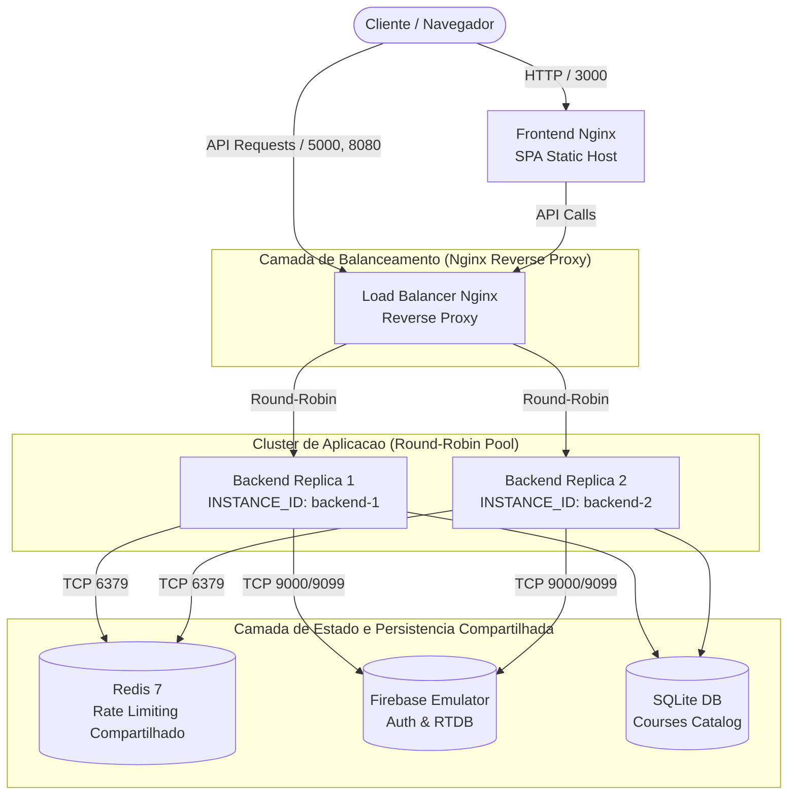

# Arquitetura de Alta Disponibilidade e Balanceamento de Carga

Este documento descreve a arquitetura de alta disponibilidade (HA), escalabilidade horizontal e balanceamento de carga da plataforma **CourseSphere**, implementada com proxy reverso Nginx e múltiplas réplicas do backend.

---

## 1. Topologia da Arquitetura

O CourseSphere opera sob uma topologia em camadas (*multi-tier*), desacoplando a camada de entrada e roteamento da execução da lógica de negócio:



---

## 2. Especificação do Balanceador de Carga (Nginx)

O serviço `load-balancer` é baseado na imagem oficial `nginx:1.27-alpine` e atua como o ponto de terminação e roteamento HTTP da infraestrutura.

### 2.1 Configuração de Upstream e Algoritmo

```nginx
upstream backend_upstream {
    # Algoritmo padrao: Round-Robin com distribuicao ciclica e uniforme
    server backend-1:5000 max_fails=3 fail_timeout=10s;
    server backend-2:5000 max_fails=3 fail_timeout=10s;
    keepalive 32;
}
```

- **Algoritmo:** *Round-Robin* puro. As requisições são alternadas sequencialmente entre os nós disponíveis no pool.
- **Detecção Passiva de Falhas:** Caso um nó retorne erros de conexão ou HTTP 502/503/504 por 3 vezes consecutivas (`max_fails=3`), ele é temporariamente removido da escala de distribuição por 10 segundos (`fail_timeout=10s`).
- **Tolerância a Falhas e Failover Imediato:** A diretiva `proxy_next_upstream error timeout http_502 http_503 http_504;` garante que requisições que falharem em um nó sejam automaticamente repassadas ao outro nó antes de enviar qualquer erro ao cliente.
- **Conexões Persistentes (`keepalive 32`):** Reduz o overhead de *handshakes* TCP entre o proxy reverso e os workers do Gunicorn.

### 2.2 Headers de Rastreabilidade e Transparência

O Load Balancer e o middleware de logging injetam e propagam cabeçalhos de observabilidade em todas as respostas:

| Header | Origem | Descrição |
| :--- | :--- | :--- |
| `X-Request-ID` | Load Balancer / Backend | UUIDv4 único gerado por requisição para tracing distribuído. |
| `X-Instance-ID` | Backend Replica | Identificador único do pod/contêiner (`backend-1`, `backend-2`). |
| `X-Upstream-Server` | Load Balancer | Endereço IP e porta interna da réplica que processou a requisição. |
| `X-Forwarded-For` | Load Balancer | IP de origem do cliente para aplicação correta de Rate Limiting. |

---

## 3. Estado Compartilhado e Statelessness dos Backends

Para viabilizar a escalabilidade horizontal sem inconsistência de sessão:
1. **Autenticação:** Baseada em tokens JWT/Bearer emitidos pelo Firebase. Qualquer nó valida o token de maneira independente consultando o Firebase Admin SDK (ou Emulator).
2. **Rate Limiting:** Todas as réplicas utilizam o cluster compartilhado Redis (`redis://redis:6379/0`). Tentativas de requisição são agregadas centralmente no Redis, impedindo que um atacante burle limites de taxa alternando entre nós.
3. **Persistência de Dados:** O catálogo relacional SQLite é sincronizado e o Firebase Realtime Database atua como armazenamento centralizado de mensagens e perfis.

---

## 4. Endpoints de Verificação e SRE

- `GET /lb-health`: Endpoint exposto diretamente pelo Load Balancer (porta 5000 e 8080) retornando status operacional do proxy sem onerar os backends:
  ```json
  {"status":"UP","role":"load-balancer","algorithm":"round-robin"}
  ```
- `GET /health`: Endpoint de *liveness probe* encaminhado pelo proxy aos nós de backend.
- `GET /ready`: Endpoint de *readiness probe* verificando a conectividade com banco de dados, Redis e Firebase.
- `GET /metrics`: Métricas do Prometheus coletadas de cada instância.

