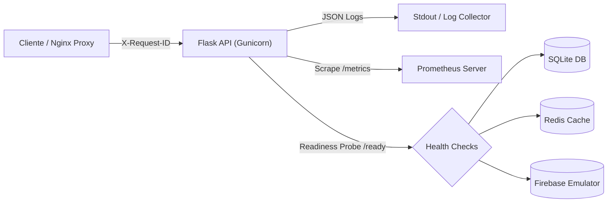

# Governança de Confiabilidade e Observabilidade (SRE)
**Projeto:** CourseSphere — AppSec & Confiabilidade  
**Data:** 28/10/2026  
**Status:** Implementado e Homologado  

---

## 1. Visão Geral da Arquitetura de Observabilidade

A infraestrutura de observabilidade e confiabilidade do CourseSphere foi projetada sobre três pilares essenciais de Engenharia de Confiabilidade de Sites (SRE):
1. **Logs Estruturados com Rastreamento Distribuído (Correlation ID):** Todos os eventos de acesso e aplicação são serializados em JSON com `request_id` (`X-Request-ID`), latência em milissegundos e identificador de instância.
2. **Sondas de Saúde (Liveness & Readiness Probes):** Endpoints desacoplados para validação de ciclo de vida de container (`/health`) e prontidão de tráfego baseada em dependências (`/ready`).
3. **Métricas no Padrão OpenMetrics / Prometheus:** Coleta em tempo real de contadores de requisições, histogramas de latência e gauges de integridade de dependências via `/metrics`.



---

## 2. Acordos e Metas de Confiabilidade (SLIs, SLOs e Error Budget)

### 2.1 Indicadores de Nível de Serviço (SLIs)

1. **SLI de Disponibilidade (Availability SLI):**
   $$\text{SLI}_{\text{disp}} = \frac{\sum \text{Requisições com Status } < 500}{\sum \text{Total de Requisições Válidas}} \times 100$$
   *Nota: Erros de cliente (4xx) decorrentes de autenticação ou validação não contabilizam falha de disponibilidade do serviço.*

2. **SLI de Latência (Latency SLI):**
   $$\text{SLI}_{\text{lat}} = \frac{\sum \text{Requisições atendidas em } \le 200\text{ms}}{\sum \text{Total de Requisições}} \times 100$$
   Medido via métrica Prometheus `http_request_duration_seconds_bucket{le="0.2"}`.

---

### 2.2 Objetivos de Nível de Serviço (SLOs) — Janela Móvel de 30 Dias

| Serviço / Endpoint | Indicador (SLI) | Meta (SLO) | Justificativa de Negócio |
|---|---|---|---|
| **Catálogo de Cursos (`/courses`)** | Disponibilidade | **99.9%** | Consulta essencial para navegação de estudantes; falha paralisa o fluxo principal. |
| **Catálogo de Cursos (`/courses`)** | Latência (p95) | **$\le 100$ ms** | Leitura rápida sobre banco indexado SQLite local. |
| **API Geral (Escrita e Autenticação)** | Disponibilidade | **99.5%** | Operações de perfil e mensagens toleram breves degradações transitórias. |
| **API Geral (Escrita e Autenticação)** | Latência (p95) | **$\le 250$ ms** | Envolve validação criptográfica de token JWT via Firebase. |
| **Consultas de Chat (`/users/query`)** | Disponibilidade | **99.0%** | Depende de stubs e integrações externas assíncronas. |

---

### 2.3 Orçamento de Erro (Error Budget) e Políticas de Ação

Considerando o SLO de Disponibilidade Geral de **99.5%** em um período padrão de 30 dias ($43.200$ minutos):
- **Tempo Máximo de Degradação Permitido (Error Budget):**
  $$\text{Error Budget} = 43.200 \text{ min} \times (1 - 0.995) = 216 \text{ minutos (3h 36min)}$$
- **Política de Consumo do Error Budget (Burn Rate Policy):**
  - **Burn Rate 1x:** Consumo normal do orçamento ($100\%$ em 30 dias). Apenas monitoramento de rotina.
  - **Burn Rate 2x a 5x:** Alerta de prioridade média no Slack/Teams. Revisão de deploys recentes.
  - **Burn Rate > 14.4x:** Consome $10\%$ do orçamento em 5 horas. Dispara acionamento *pager* para o engenheiro de plantão (on-call) e suspensão automática de novos lançamentos de features (congelamento de código) até a restauração dos índices de confiabilidade.

---

## 3. Arquitetura de Sondas e Ciclo de Vida do Container

### 3.1 Liveness Probe (`GET /health`)
- **Objetivo:** Informar ao orquestrador se o processo worker está vivo e processando requisições HTTP.
- **Comportamento:** Retorno imediato `HTTP 200` com tempo de atividade (`uptime_seconds`).
- **Ação em Caso de Falha:** O orquestrador envia `SIGTERM` e reinicia o container após 3 falhas consecutivas.

### 3.2 Readiness Probe (`GET /ready`)
- **Objetivo:** Determinar se o container está pronto para receber tráfego de produção do balanceador de carga.
- **Dependências Validadas Dinamicamente:**
  1. Conexão e leitura no banco SQLite (`SELECT 1`).
  2. Inicialização ativa da SDK Firebase Admin.
  3. Conexão e teste de ping no Redis.
- **Comportamento:**
  - Todas as dependências operacionais: `HTTP 200` com `"status": "READY"`.
  - Qualquer dependência inacessível: `HTTP 503` com `"status": "NOT_READY"` detalhando o componente degradado.
- **Ação em Caso de Falha:** O load balancer (Nginx) remove imediatamente a réplica do pool ativo sem reiniciar o processo.

---

## 4. Esquema de Logs Estruturados em JSON

Todos os logs de requisição são emitidos em `stdout` no seguinte formato:

```json
{
  "timestamp": "2026-10-28T21:44:22.180Z",
  "level": "INFO",
  "request_id": "8f3e2b10-6c94-4d89-9a21-4f91e32d8b12",
  "instance_id": "backend-1",
  "method": "GET",
  "path": "/courses",
  "status_code": 200,
  "latency_ms": 1.45,
  "client_ip": "172.20.0.1",
  "uid": "10X7ZG5Zk26mIEtdNanMTUnumNWs",
  "user_agent": "Mozilla/5.0 (Windows NT 10.0; Win64; x64)..."
}
```

---

## 5. Exposição de Métricas Prometheus (`GET /metrics`)

O endpoint `/metrics` exporta métricas instrumentadas em conformidade com o padrão OpenMetrics:
- `http_requests_total{method, endpoint, status}`: Contagem cumulativa de requisições.
- `http_request_duration_seconds_bucket{le, method, endpoint}`: Histograma de latência para cálculo preciso de percentis ($p50, p90, p95, p99$).
- `http_requests_in_flight`: Medidor em tempo real de requisições em processamento simultâneo.
- `dependency_up{dependency}`: Estado de saúde binário ($1 = \text{UP}, 0 = \text{DOWN}$) para cada serviço externo.

