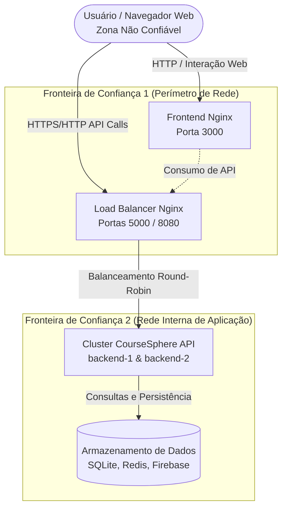
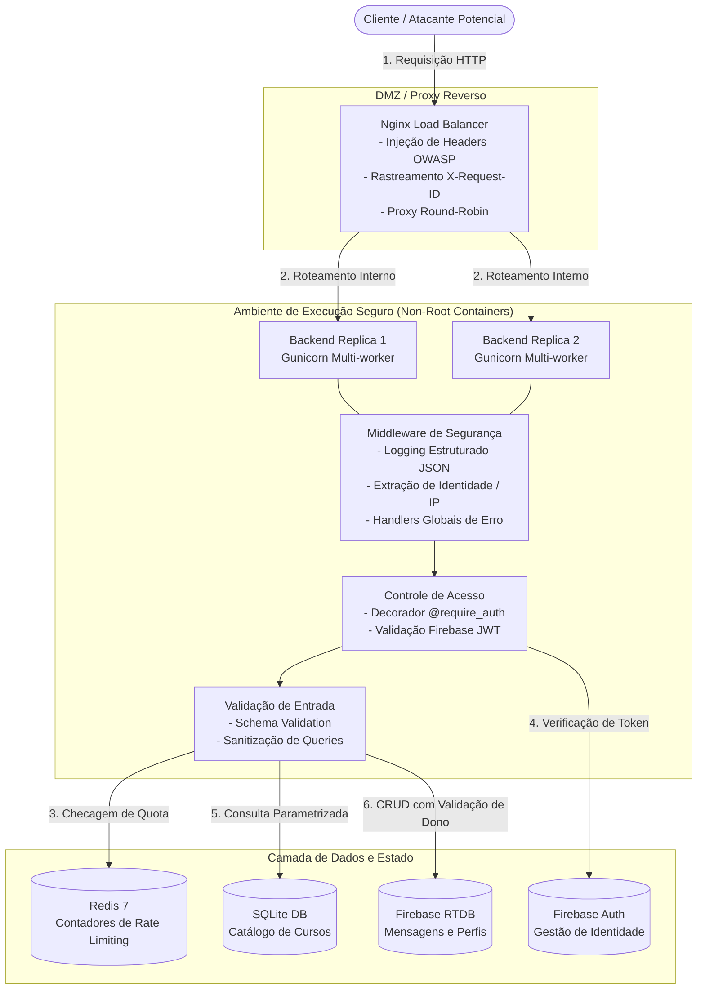
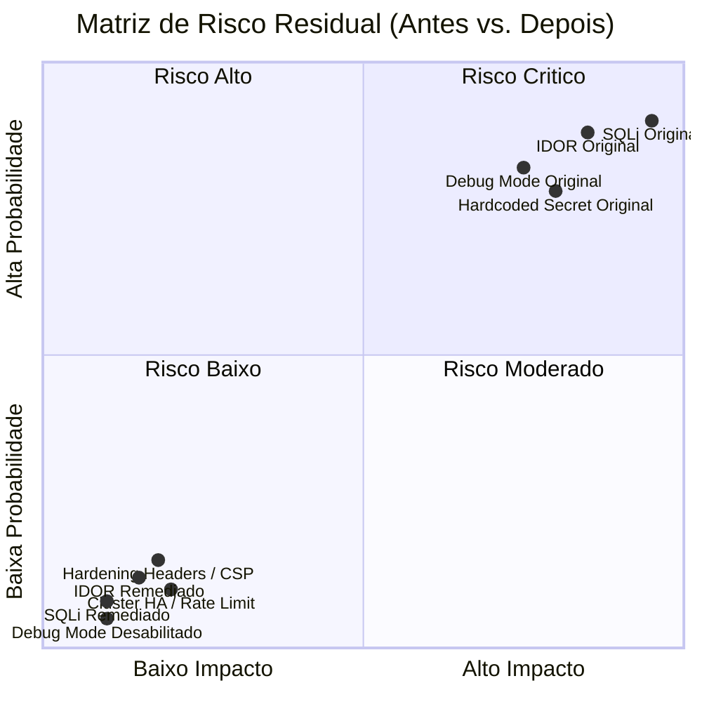

# Modelagem de Ameaças (Threat Modeling) — STRIDE & DFD

**Plataforma:** CourseSphere  
**Metodologia:** STRIDE (Microsoft Threat Modeling Framework)  
**Escopo:** Frontend SPA, Load Balancer Nginx, Cluster Backend Flask, Cache Redis, Firebase Auth/RTDB e Catálogo SQLite  

---

## 1. Visão Geral e Fronteiras de Confiança

A modelagem de ameaças visa identificar sistematicamente vetores de risco e vulnerabilidades arquiteturais antes que possam ser exploradas em ambientes de produção. 

A plataforma define três zonas de confiança distintas:
1. **Zona Não Confiável (Untrusted Zone):** A rede pública da Internet, o navegador do cliente e potenciais atacantes.
2. **Zona DMZ / Roteamento (Perimeter Zone):** O Load Balancer e Proxy Reverso Nginx, responsável pela terminação HTTP, cabeçalhos de segurança e distribuição uniforme de tráfego.
3. **Zona Confiável da Aplicação e Dados (Trusted Application Zone):** A rede interna em contêiner (`coursesphere-net`) isolando réplicas do backend, o cluster Redis e os dados relacionais SQLite / Firebase.

---

## 2. Diagramas de Fluxo de Dados (DFD)

### 2.1 DFD Nível 0 — Diagrama de Contexto

---

### 2.2 DFD Nível 1 — Decomposição Detalhada dos Processos

---

## 3. Matriz de Análise STRIDE & Controles Implementados

A análise STRIDE avalia as seis categorias fundamentais de ameaças contra cada elemento da arquitetura CourseSphere:

| Categoria STRIDE | Descrição da Ameaça no Contexto CourseSphere | Risco Original (Baseline) | Mitigação Arquitetural e Controles Implementados |
| :--- | :--- | :--- | :--- |
| **S — Spoofing** *(Falsificação de Identidade)* | Atacante forjar identidade de outro usuário para obter acesso indevido ou emitir chamadas de API sem credenciais válidas. | **Crítico.** Endpoints não exigiam validação criptográfica estrita ou aceitavam tokens arbitrários na query string. | **Implementado:** Decorador `@require_auth` com verificação criptográfica obrigatória via Firebase Admin SDK; rejeição de requisições sem header `Authorization: Bearer <token>`. |
| **T — Tampering** *(Adulteração de Dados)* | Manipulação de consultas SQL (SQL Injection), injeção de parâmetros em URLs ou alteração/exclusão de chats pertencentes a outros usuários (IDOR). | **Crítico.** Consultas SQL montadas via interpolação de strings (`f-string`) e rotas `DELETE /chats/<id>` sem verificação de posse. | **Implementado:** Parametrização 100% com bind variables (`?`) no SQLite; verificação estrita de propriedade (`Firebase.get_chat(user_id, chat_id)`); regras de segurança no RTDB (`auth.uid === $uid`). |
| **R — Repudiation** *(Repúdio de Ações)* | Usuário malicioso ou atacante executa ações críticas (exclusão de mensagens, ataques de força bruta) sem que haja registro auditável de sua identidade. | **Alto.** Ausência de logs estruturados e de identificador unificado de correlação de requisições. | **Implementado:** Middleware de structured logging em formato JSON contendo `X-Request-ID` (UUIDv4), timestamp ISO 8601, IP de origem, UID autenticado, método, rota, status HTTP e instância. |
| **I — Information Disclosure** *(Vazamento de Informações)* | Exposição de variáveis de ambiente, paths do sistema e versões de pacotes via traceback de erro 500; CORS irrestrito; tokens gravados em logs de proxy via query string. | **Alto.** `debug=True` habilitado; CORS aberto (`*`); token exposto na URL em `GET /users/info`. | **Implementado:** `debug=False` em produção; interceptadores globais de erro retornando respostas sanitizadas; CORS restrito a origens homologadas (`ALLOWED_ORIGINS`); token extraído exclusivamente via cabeçalho. |
| **D — Denial of Service** *(Negação de Serviço)* | Esgotamento de recursos do servidor através de rajadas de requisições (força bruta / flood), envio de payloads excessivos ou falha de instância única (SPOF). | **Alto.** Servidor de nó único sem limite de taxa de requisições e sem limitação de payload. | **Implementado:** Rate limiting distribuído com Redis 7 (`Flask-Limiter`); limite rígido de payload (`MAX_CONTENT_LENGTH = 1MB`); cluster com múltiplas réplicas e failover automático no Nginx. |
| **E — Elevation of Privilege** *(Elevação de Privilégio)* | Usuário comum manipulando seu próprio perfil para injetar campos administrativos (`role: "admin"`) ou executando comandos via contêiner root. | **Alto.** Mass assignment potencial no RTDB e processos rodando como root no sistema operacional do contêiner. | **Implementado:** Validação de schemas com rejeição de campos não declarados; contêineres executando sob usuário sem privilégios (`appuser:appgroup`); isolamento na rede interna `coursesphere-net`. |

---

## 4. Avaliação de Risco Residual

Após a implementação das camadas de mitigação ofensivas e defensivas:

- **Risco Primário Eliminado:** As vulnerabilidades exploráveis de execução arbitrária, injeção e violação de dados foram completamente anuladas.
- **Risco Residual Aceitável:** O tráfego residual depende da higienização contínua de bibliotecas de terceiros (gestão contínua de patches SCA via dependabot/auditorias periódicas).
